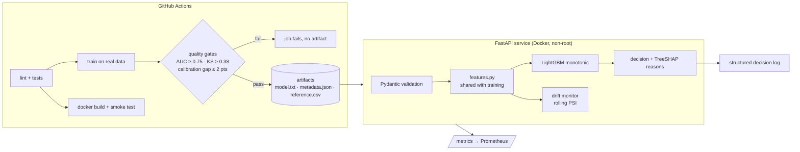
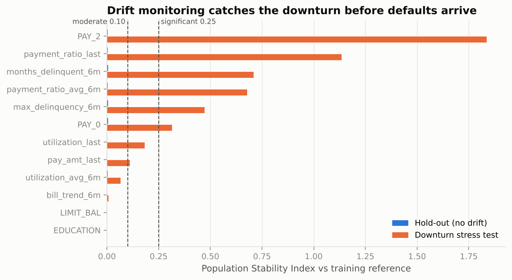

# Credit Risk Scoring API: from notebook to production

[](https://github.com/c4r0l13/credit-risk-api/actions/workflows/ci.yml)


The champion model from [**credit-risk-scorecard**](https://github.com/c4r0l13/credit-risk-scorecard) deployed the way a fintech would run it: a validated API that returns a decision **with reasons**, quality gates that block bad models in CI, framework-native artifacts, Prometheus metrics and live drift monitoring.

```bash
curl -X POST localhost:8000/v1/score -H 'content-type: application/json' -d '{
  "application_id": "app-000123", "LIMIT_BAL": 50000, "EDUCATION": 2,
  "pay_status": [2, 2, 0, 0, 0, 0],
  "bill_amt": [46990, 48233, 49291, 28314, 28959, 29547],
  "pay_amt": [0, 2000, 1500, 1000, 1000, 800]
}'
```
```json
{
  "application_id": "app-000123",
  "probability_of_default": 0.7111,
  "decision": "decline",
  "reasons": ["Recent payment delay on the account", "Severity of past payment delays", "Small last payment amount"],
  "model_version": "20261030-4edce6d"
}
```

## Architecture



## Results

| | Value |
|---|---|
| Model | Monotonic LightGBM, 12 features (11 monotonic-constrained) |
| Test AUC / KS | 0.781 / 0.432 |
| Policy | Approve if PD ≤ cutoff that keeps defaults among approved ≤ 12% |
| Approval rate / bad rate (test) | 66.9% / 11.3% |
| Latency, single request (p50 / p95 / p99) | 18 / 25 / 29 ms, including per-applicant reasons |
| Throughput, batch of 1,000 | ~2,300 applications/s on one CPU core |

Latency was measured with `make bench` against a local uvicorn worker over HTTP.

### Drift monitoring catches a downturn before defaults show up

Default labels arrive months after a decision, so a model can degrade silently. Drift on the *inputs* is visible immediately. The offline study (`make drift`) replays the hold-out set and then a simulated downturn in which 30% of customers fall one month further behind, balances grow 15% and payments shrink 20%:

| Scenario | Max feature PSI | Score PSI | Mean PD | Approval rate |
|---|---:|---:|---:|---:|
| Hold-out (no drift) | 0.006 | 0.005 | 22.1% | 66.9% |
| **Downturn stress test** | **1.84** | **0.31** | 30.4% | **44.6%** |



The same PSI is served live at `GET /v1/monitoring/drift` over the last 2,000 scored applications.

## Engineering decisions

| Decision | Why |
|---|---|
| **One `features.py` for training and serving** | Training/serving skew is the most common silent failure of deployed models. The service also refuses to start if the artifact's feature list differs from the code's. |
| **Native LightGBM text model + JSON metadata, no pickle** | Pickles execute code on load, break across library versions and can't be diffed. The text model is inspectable and portable. |
| **Quality gates in CI** | Retraining runs on every push to `main` and fails the build if AUC, KS or calibration regress. A worse model cannot be promoted by accident. |
| **Validation at the edge** | Pydantic rejects negative limits, wrong history lengths and unknown fields with a 422 before anything reaches the model. |
| **Reasons only on declines** | They are what adverse-action notices require. Approvals don't need them, which keeps responses lean. |
| **Decision log without personal data** | Each decision is logged as JSON with ID, PD, decision and model version, enough for audit and monitoring without storing raw history. |
| **PSI with categorical bins for discrete features** | Quantile bins collapse on features like payment status (mostly 0), which hid the shift in `PAY_2` during testing. Low-cardinality features now get one bin per value. |
| **Config read at startup, not at import** | The same image serves any artifact set via `ARTIFACT_DIR`. |
| **One worker per container** | Prometheus counters and the drift window live in-process, so the service scales with replicas behind a load balancer rather than with uvicorn workers. |

## API

| Method | Path | Description |
|---|---|---|
| GET | `/health` | Liveness and model version (used by the Docker healthcheck) |
| GET | `/v1/model` | Version, training date, metrics, cutoff, features, data hash |
| POST | `/v1/score` | Score one application |
| POST | `/v1/score/batch` | Score up to 1,000 applications |
| GET | `/v1/monitoring/drift` | PSI and status per feature over the rolling window |
| GET | `/metrics` | Prometheus: decisions by outcome, latency histogram, PD distribution |
| GET | `/docs` | Interactive OpenAPI documentation |

## Run it

```bash
# Docker (artifacts are committed, so this works straight away)
docker compose up --build
open http://localhost:8000/docs

# Local development
python -m venv .venv && source .venv/bin/activate
make install
make data && make train   # retrain with quality gates -> artifacts/
make serve                # http://localhost:8000/docs
make test                 # 10 tests, synthetic model, no data needed
make drift                # offline drift study -> reports/
```

## Project structure

```
credit-risk-api/
├── app/
│   ├── main.py         # FastAPI app, middleware, metrics, endpoints
│   ├── schemas.py      # request/response contracts
│   ├── features.py     # feature engineering shared with training
│   ├── model.py        # artifact loading, scoring, reason codes
│   └── drift.py        # PSI + thread-safe rolling drift monitor
├── training/train.py   # training with quality gates -> artifacts/
├── monitoring/         # drift study and latency benchmark
├── artifacts/          # model.txt, metadata.json, reference.csv
├── tests/              # API, validation, monotonicity, drift, startup checks
├── Dockerfile          # slim, non-root, healthcheck
├── docker-compose.yml
├── MODEL_CARD.md
└── .github/workflows/ci.yml   # test -> train with gates -> docker smoke test
```

## What I would add with real traffic

- **Shadow deployment** of each new candidate next to the champion before switching.
- **Outcome monitoring** once labels mature (60–90 days): realized default rate per score band vs predicted.
- **A feature store** if several models share inputs, to keep feature definitions in one place across teams.
